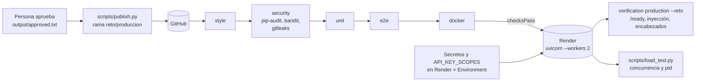

# Arquitectura del HR Assistant

Un asistente de RH: una página web y una API FastAPI sin estado. Desde la sesión 2, cada petición tiene un
`request_id`, deja un log JSON y alimenta las métricas del proceso; las trazas de LangSmith son opcionales.
Desde la sesión 3, cada pregunta se enruta a un modelo pequeño o grande, el historial se recorta, la salida tiene
tope y cada respuesta dice cuánto costó; el modelo real es Workers AI a través de AI Gateway. Desde la sesión 4,
cada cliente entra con su clave y tiene un límite de peticiones, producción se niega a arrancar con
configuración insegura y se publica en Render solo si pasa el CI.

Desde el reto (parte 1) es un **sistema multiagente**: `guard` revisa la entrada, `supervisor` reparte entre los
especialistas `directory` y `policies` según reglas y permisos del cliente, y `reviewer` valida la salida. El
modelo se reintenta y, si el grande sigue fallando, responde el pequeño. El contenedor corre varios procesos, y
cada respuesta pasa por capas HTTP de seguridad.

## Petición

```mermaid
flowchart LR
    U[Personal de RH] --> P["Página web<br/>index.html + app.js<br/>(clave en sessionStorage,<br/>agentes, aviso PII)"]
    P -- "POST /ask + X-API-Key" --> HL["http_layers.py<br/>encabezados de seguridad"]
    HL --> MW["middleware.py<br/>request_id, latencia, 500"]
    MW --> SE["security.py<br/>clave 401, permiso metrics 403"]
    SE --> RL["ratelimit.py<br/>429 por cliente"]
    RL --> SZ["http_layers.py<br/>tamaño 413"]
    SZ --> M["main.py<br/>validación 422,<br/>/ask, /ready, /metrics"]
    M --> PL["pipeline.py<br/>orquestador"]
    PL --> GU["guard.py<br/>injection.py 400<br/>pii.py tapa o 400"]
    GU --> R["router.py<br/>un modelo por pregunta"]
    R --> SU["supervisor.py<br/>reglas + scopes.py, 403"]
    SU --> DA["Agent directory<br/>get_employee,<br/>search_by_department"]
    SU --> PA["Agent policies<br/>search_policy"]
    DA --> D["directory.py"] --> J[("data/employees.json")]
    PA --> PO["policies.py"] --> PJ[("data/policies.json")]
    DA -- "complete(messages)" --> L["llm.py<br/>reintentos, timeout"]
    PA -- "complete(messages)" --> L
    L -.-> F["FakeModel<br/>(por especialista)"]
    L -.-> G["GatewayModel"] --> CF[("Cloudflare AI Gateway<br/>Workers AI")]
    PL -- "MODEL_LARGE falla:<br/>reinicia con MODEL_SMALL" --> SU
    PL --> RV["reviewer.py<br/>vacía, prompt, fundamento,<br/>PII, largo"]
    PL --> PR["pricing.py"] --> PP[("data/model_prices.json")]
    PL -- "tool_call, tool_denied,<br/>pii_detected, fallback..." --> AU["audit.py"]
    SE -- "auth_failed, rate_limited,<br/>forbidden" --> AU
    AU --> LG["logs.py"] --> SO[("stdout JSON")]
    MW --> ME["metrics.py<br/>por proceso"]
    DA -.trazas opcionales.-> T["tracing.py"] -.-> LS[("LangSmith")]
    C["config.py"] --> CO["compliance.py"]
    C --> M
```

## Publicación

## Piezas

| Módulo | Responsabilidad |
| --- | --- |
| `config.py` | Lee y valida las variables de entorno; si alguna es inválida, la app no arranca |
| `compliance.py` | En producción impide arrancar con configuración insegura, sin guard, sin PII o sin scopes |
| `security.py` | Clave por cliente, rutas públicas, permiso `metrics` y auditoría de 401 y 429 |
| `scopes.py` | Lee `API_KEY_SCOPES` y da los permisos de cada cliente |
| `ratelimit.py` | Límite de peticiones por cliente y minuto, por proceso |
| `http_layers.py` | Encabezados de seguridad, CSP, HSTS en producción y tope de tamaño del cuerpo |
| `pipeline.py` | Orquesta guard, supervisor, especialistas y reviewer; respaldo al modelo pequeño |
| `guard.py` | Revisa pregunta e historial: inyección y PII de entrada |
| `injection.py` | Reglas de inyección con id, en un solo lugar |
| `pii.py` | Detecta y tapa datos personales por tipo |
| `supervisor.py` | Elige especialistas por reglas y los filtra por permisos |
| `specialists.py` | Define cada especialista: prompt, herramientas y validadores de argumentos |
| `agent.py` | Bucle con tope y protocolo JSON; solo ejecuta las herramientas del especialista |
| `reviewer.py` | Valida la respuesta final antes de devolverla |
| `audit.py` | Eventos `audit` con cliente, acción y resultado, sin texto ni claves |
| `text.py` | Normaliza texto sin mayúsculas ni acentos |
| `directory.py` | Empleados en solo lectura |
| `policies.py` | Políticas de RH en solo lectura y `search_policy` |
| `llm.py` | Interfaz del modelo, simulados por especialista y `GatewayModel` con reintentos |
| `router.py` | Elige `MODEL_SMALL` o `MODEL_LARGE` una vez por pregunta |
| `pricing.py` | Costo en USD por modelo |
| `main.py` | `create_app()` con dependencias inyectables; `/`, `/health`, `/ready`, `/ask`, `/metrics`, `static` |
| `middleware.py` | `request_id`, latencia, evento `request`, errores 500 |
| `logs.py` | Log JSON en stdout, una línea por evento |
| `metrics.py` | Contadores, latencias, tokens y costo del proceso |
| `tracing.py` | Trazas de LangSmith opcionales y ocultas |
| `clock.py` | Reloj inyectable |
| `static/` | `index.html`, `app.js` y `app.css`: interfaz con `textContent`, agentes y avisos |

Fuera de `app/`: `Dockerfile`, `.dockerignore`, `.gitignore`, `render.yaml`, `.github/workflows/ci.yml`,
`scripts/smoke.py`, `scripts/load_test.py`, `doc/compliance-checklist.md` y `doc/security.md`.

## Principios

- Sin estado de usuario en el servidor (ADR 0001); métricas y límite son del proceso, también con varios
  workers (ADR 0005, ADR 0010, ADR 0015).
- El modelo es intercambiable (ADR 0002); el real va por AI Gateway (ADR 0009), con reintentos y respaldo
  (ADR 0015).
- Cada bucle de agente tiene tope (ADR 0003); cada especialista solo usa sus herramientas y el supervisor
  decide por reglas (ADR 0013).
- Barandales deterministas en capas y en orden fijo; el modelo nunca ve PII tapada (ADR 0014).
- Cada petición se rastrea por `request_id` y cliente, sin datos personales ni claves (ADR 0004, ADR 0010).
- Las trazas externas son opcionales y ocultas (ADR 0006); en producción es obligatorio (ADR 0011).
- El modelo se elige por regla (ADR 0007) y cada respuesta dice su costo (ADR 0008).
- Negar por omisión: rutas, herramientas y especialistas (ADR 0010, ADR 0013).
- La configuración insegura no arranca en producción (ADR 0011).
- Solo se publica lo que pasa el CI y una persona aprobó (ADR 0012).
- Las dependencias (configuración, modelos, cliente HTTP, datos, reloj, `sleep`, log, tracer, ids) se inyectan
  en `create_app`. Ninguna prueba toca la red ni espera de verdad.
