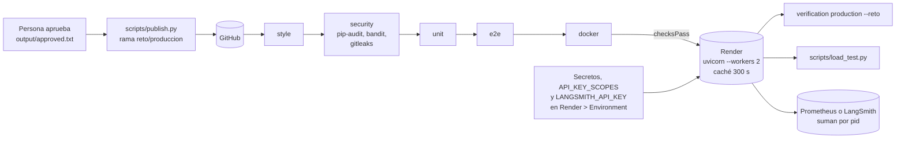

# Arquitectura del HR Assistant

Un asistente de RH: una página web y una API FastAPI sin estado. Desde la sesión 2, cada petición tiene un
`request_id`, deja un log JSON y alimenta las métricas del proceso; las trazas de LangSmith son opcionales.
Desde la sesión 3, cada pregunta se enruta a un modelo pequeño o grande, el historial se recorta, la salida tiene
tope y cada respuesta dice cuánto costó; el modelo real es Workers AI a través de AI Gateway. Desde la sesión 4,
cada cliente entra con su clave y tiene un límite de peticiones, producción se niega a arrancar con
configuración insegura y se publica en Render solo si pasa el CI.

Desde el reto (parte 1) es un **sistema multiagente**: `guard` revisa la entrada, `supervisor` reparte entre los
especialistas `directory` y `policies` según reglas y permisos del cliente, y `reviewer` valida la salida. El
modelo se reintenta y, si el grande sigue fallando, responde el pequeño. El contenedor corre varios procesos, y
cada respuesta pasa por capas HTTP de seguridad.

Desde el reto (parte 2) cada agente es **visible**: un registro de pasos alimenta a la vez el evento
`agent_step`, las métricas por agente, cliente y modelo, Prometheus, las alertas y una traza de LangSmith con un
nodo por agente. `GET /dashboard` muestra todo. Dos palancas nuevas bajan el costo: la caché de respuestas y el
presupuesto diario por cliente.

## Petición

```mermaid
flowchart LR
    U[Personal de RH] --> P["Página web<br/>index.html + app.js"]
    U --> DB["/dashboard<br/>dashboard.html (un archivo)<br/>lee /metrics cada 10 s"]
    P -- "POST /ask + X-API-Key" --> HL["http_layers.py<br/>encabezados, CSP con hash"]
    DB -- "GET /metrics + X-API-Key" --> HL
    HL --> MW["middleware.py<br/>request_id, latencia, 500,<br/>alertas"]
    MW --> SE["security.py<br/>clave 401, permiso metrics 403"]
    SE --> RL["ratelimit.py<br/>429 por cliente"]
    RL --> SZ["http_layers.py<br/>tamaño 413"]
    SZ --> M["main.py<br/>422, /ask, /ready, /metrics,<br/>/metrics/prometheus, /dashboard"]
    M --> PL["pipeline.py<br/>orquestador"]
    PL --> ST["agent_steps.py<br/>un paso por agente:<br/>latencia y outcome"]
    PL --> GU["guard.py<br/>injection.py 400, pii.py"]
    GU --> R["router.py<br/>un modelo por pregunta"]
    R --> SU["supervisor.py<br/>reglas + scopes.py, 403"]
    SU --> BU["budget.py<br/>429 presupuesto diario"]
    BU --> RC{"response_cache.py<br/>¿acierto?"}
    RC -- "sí: cache response,<br/>costo 0" --> M
    RC -- "no" --> DA["Agent directory"]
    RC -- "no" --> PA["Agent policies"]
    DA --> D["directory.py"] --> J[("data/employees.json")]
    PA --> PO["policies.py"] --> PJ[("data/policies.json")]
    DA -- "complete(messages)" --> L["llm.py<br/>reintentos, respaldo"]
    PA -- "complete(messages)" --> L
    L -.-> F["FakeModel"]
    L -.-> G["GatewayModel"] --> CF[("Cloudflare AI Gateway<br/>Workers AI")]
    PL --> RV["reviewer.py"]
    RV -- "respuesta guardable" --> RC
    PL --> PR["pricing.py"] --> PP[("data/model_prices.json")]
    PL -- "audit" --> AU["audit.py"]
    AU -- "observador:<br/>guardrails" --> ME
    AU --> LG["logs.py<br/>agent_step, agent_run,<br/>audit, alert"] --> SO[("stdout JSON")]
    ST --> ME["metrics.py<br/>por proceso, ventanas,<br/>by_agent/client/model"]
    ME --> AL["alerts.py<br/>4 reglas"]
    ME --> PM["prometheus.py<br/>texto 0.0.4, pid"]
    ST -.nodo por agente.-> T["tracing.py<br/>raíz ask + hijos,<br/>LANGSMITH_PROJECT"] -.-> LS[("LangSmith")]
    C["config.py"] --> CO["compliance.py"]
    C --> M
```

## Publicación

## Piezas

| Módulo | Responsabilidad |
| --- | --- |
| `config.py` | Lee y valida las variables de entorno; si alguna es inválida, la app no arranca |
| `compliance.py` | En producción impide arrancar con configuración insegura, sin guard, sin PII o sin scopes |
| `security.py` | Clave por cliente, rutas públicas (también `/dashboard`), permiso `metrics` y auditoría de 401 y 429 |
| `scopes.py` | Lee `API_KEY_SCOPES` y da los permisos de cada cliente |
| `ratelimit.py` | Límite de peticiones por cliente y minuto, por proceso |
| `http_layers.py` | Encabezados de seguridad, CSP con hash del tablero, HSTS en producción y tope del cuerpo |
| `pipeline.py` | Orquesta guard, supervisor, presupuesto, caché, especialistas y reviewer; respaldo al modelo pequeño |
| `agent_steps.py` | Un paso por agente: latencia, `outcome` y nodo de la traza |
| `guard.py` | Revisa pregunta e historial: inyección y PII de entrada |
| `injection.py` | Reglas de inyección con id, en un solo lugar |
| `pii.py` | Detecta y tapa datos personales por tipo |
| `supervisor.py` | Elige especialistas por reglas y los filtra por permisos |
| `budget.py` | Presupuesto diario de costo por cliente (día UTC), por proceso |
| `response_cache.py` | Caché LRU con TTL de respuestas revisadas, por permisos e historial |
| `specialists.py` | Define cada especialista: prompt, herramientas y validadores de argumentos |
| `agent.py` | Bucle con tope y protocolo JSON; solo ejecuta las herramientas del especialista |
| `reviewer.py` | Valida la respuesta final antes de devolverla |
| `audit.py` | Eventos `audit` sin texto ni claves; avisa a las métricas de barandales |
| `text.py` | Normaliza texto sin mayúsculas ni acentos |
| `directory.py` | Empleados en solo lectura |
| `policies.py` | Políticas de RH en solo lectura y `search_policy` |
| `llm.py` | Interfaz del modelo, simulados por especialista y `GatewayModel` con reintentos |
| `router.py` | Elige `MODEL_SMALL` o `MODEL_LARGE` una vez por pregunta |
| `pricing.py` | Costo en USD por modelo |
| `main.py` | `create_app()` con dependencias inyectables y todas las rutas |
| `middleware.py` | `request_id`, latencia, evento `request`, errores 500 y eventos `alert` |
| `logs.py` | Log JSON en stdout, una línea por evento |
| `metrics.py` | Conteos y ventanas del proceso: por agente, cliente, modelo y ruta; barandales, caché y costo |
| `alerts.py` | Reglas de las 4 alertas, sin estado |
| `prometheus.py` | `/metrics/prometheus` en formato de texto, con `pid` |
| `tracing.py` | Trazas de LangSmith opcionales y ocultas: raíz `ask`, un hijo por agente |
| `clock.py` | Reloj inyectable |
| `static/` | `index.html`, `app.js`, `app.css` y `dashboard.html` (tablero de un archivo) |

Fuera de `app/`: `Dockerfile`, `.dockerignore`, `.gitignore`, `render.yaml`, `.github/workflows/ci.yml`,
`scripts/smoke.py`, `scripts/load_test.py`, `doc/compliance-checklist.md`, `doc/security.md`,
`doc/observability.md` y `doc/cost-analysis.md`.

## Principios

- Sin estado de usuario en el servidor (ADR 0001); métricas, límite, caché y presupuesto son del proceso,
  también con varios workers (ADR 0005, ADR 0010, ADR 0015, ADR 0017).
- El modelo es intercambiable (ADR 0002); el real va por AI Gateway (ADR 0009), con reintentos y respaldo
  (ADR 0015).
- Cada bucle de agente tiene tope (ADR 0003); cada especialista solo usa sus herramientas y el supervisor
  decide por reglas (ADR 0013).
- Barandales deterministas en capas y en orden fijo; el modelo nunca ve PII tapada (ADR 0014). La caché va
  después de todos los controles y solo guarda respuestas revisadas (ADR 0017).
- Cada petición se rastrea por `request_id` y cliente, sin datos personales ni claves (ADR 0004, ADR 0010); cada
  agente deja un paso que coincide en log, métricas y traza (ADR 0016).
- Las trazas externas son opcionales y ocultas (ADR 0006); en producción es obligatorio (ADR 0011).
- El modelo se elige por regla (ADR 0007), cada respuesta dice su costo (ADR 0008) y de dónde vino (`cache`).
- Negar por omisión: rutas, herramientas y especialistas (ADR 0010, ADR 0013). El código en línea solo corre si
  su hash está en la CSP (ADR 0018).
- La configuración insegura no arranca en producción (ADR 0011).
- Solo se publica lo que pasa el CI y una persona aprobó (ADR 0012).
- Las dependencias (configuración, modelos, cliente HTTP, datos, reloj, `sleep`, log, tracer, ids) se inyectan
  en `create_app`. Ninguna prueba toca la red ni espera de verdad.
