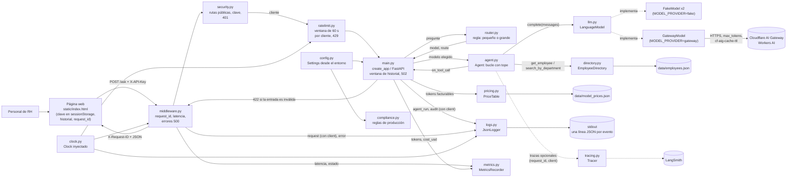
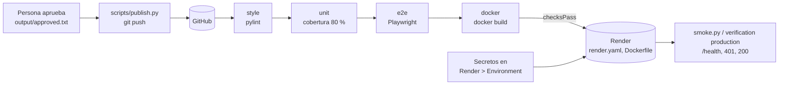

# Arquitectura del HR Assistant

Un asistente de RH: una página web, una API FastAPI sin estado y un solo agente con dos
herramientas de solo lectura sobre `data/employees.json`. Desde la sesión 2, cada petición tiene
un `request_id`, deja un log JSON y alimenta las métricas del proceso; las trazas de LangSmith son
opcionales. Desde la sesión 3, cada pregunta se enruta a un modelo pequeño o grande, el historial
se recorta a una ventana, la salida tiene tope y cada respuesta dice cuánto costó. El modelo real
es Workers AI a través de AI Gateway; el simulado sigue siendo el de omisión. Desde la sesión 4,
cada cliente entra con su clave y tiene un límite de peticiones; en producción el producto se
niega a arrancar si su configuración es insegura, y se publica en Render desde un contenedor solo
si el pipeline de CI pasa.

## Petición

## Publicación

## Piezas

| Módulo | Responsabilidad |
| --- | --- |
| `config.py` | Lee y valida las variables de entorno. Si alguna es inválida, la app no arranca |
| `compliance.py` | Con `ENVIRONMENT=production`, impide arrancar con modelo simulado, claves débiles o trazas sin ocultar |
| `security.py` | Lee `API_KEYS`, identifica al cliente por `X-API-Key` y protege todo salvo las rutas públicas |
| `ratelimit.py` | Límite de peticiones por cliente y minuto con el reloj inyectado |
| `directory.py` | Carga los empleados una vez y los consulta en solo lectura |
| `llm.py` | Interfaz `complete(messages)`, dos modelos simulados con nombre y `GatewayModel` |
| `router.py` | Regla que elige `MODEL_SMALL` o `MODEL_LARGE` y da el motivo |
| `pricing.py` | Precios por modelo desde archivo y costo en USD de una corrida |
| `agent.py` | Bucle con tope, protocolo JSON, herramientas; cuenta llamadas cacheadas |
| `main.py` | `create_app()` con dependencias inyectables; ventana, costo, 502; `/`, `/health`, `/ask`, `/metrics` |
| `middleware.py` | `request_id`, latencia, evento `request` con `client`, errores 500 y encabezado |
| `logs.py` | Log JSON en stdout, una línea por evento |
| `metrics.py` | Contadores, latencias p50/p95, tokens, costo acumulado y SLO del proceso |
| `tracing.py` | Trazas de LangSmith opcionales, apagadas por omisión, con `request_id` y `client` |
| `clock.py` | Reloj inyectable: hora UTC y tiempo monótono |
| `static/index.html` | Interfaz de RH. Campo de clave, `textContent`, historial, `request_id`, mensajes de 401 y 429 |

Fuera de `app/`: `Dockerfile`, `.dockerignore`, `.gitignore`, `render.yaml`,
`.github/workflows/ci.yml`, `scripts/smoke.py` y `doc/compliance-checklist.md`.

## Principios

- Sin estado de usuario en el servidor (ADR 0001); las métricas y el límite son del proceso
  (ADR 0005, ADR 0010).
- El modelo es intercambiable detrás de una interfaz (ADR 0002); el real va por AI Gateway y sus
  fallos son 502 (ADR 0009).
- El bucle del agente tiene tope y un protocolo estricto (ADR 0003).
- Cada petición se rastrea por su `request_id` y su cliente, sin escribir datos personales ni
  claves (ADR 0004, ADR 0010).
- Las trazas externas son opcionales y ocultan el contenido por omisión (ADR 0006); en producción
  es obligatorio (ADR 0011).
- El modelo se elige por regla, no por otro modelo (ADR 0007).
- Cada respuesta dice su costo, calculado con precios en archivo; lo cacheado no cuesta (ADR 0008).
- Negar por omisión: toda ruta pide clave salvo las públicas (ADR 0010).
- La configuración insegura no arranca en producción (ADR 0011).
- Solo se publica lo que pasa el pipeline y una persona aprobó; los secretos viven en Render
  (ADR 0012).
- Las dependencias (configuración, modelos, cliente HTTP, directorio, reloj, salida del log,
  tracer, generador de ids) se inyectan en `create_app`. Ninguna prueba toca la red.
