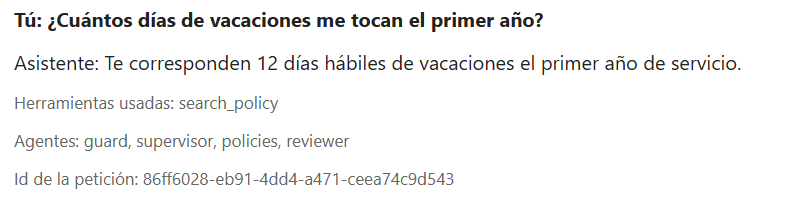

# Evidencia: detalle por pregunta con el modelo real

- **Servicio:** `https://hr-assistant-ar3g.onrender.com` (configuración de producción: enrutamiento, ventana y
  caché de respuestas).
- **Fecha:** 2026-11-20.
- **Preguntas:** las 10 de `verification/eval_set.json`, una vez cada una, con el mismo criterio de acierto que
  `verification evaluate`.

Todas las preguntas son cortas, así que el enrutador mandó las 10 al modelo pequeño
(`@cf/meta/llama-3.1-8b-instruct-fast`, ruta `simple`).

| # | Pregunta | Resultado | Respuesta (primeros 160 caracteres) | Causa |
| --- | --- | --- | --- | --- |
| 1 | ¿Quién es EMP-0004? | OK | Jorge Díaz trabaja en Tecnología como Líder técnico desde el 10 de enero de 2022 y su estado laboral es activo. | — |
| 2 | ¿Qué puesto tiene EMP-0005? | MAL | La respuesta debe tener 'answer' o 'tool'. | El 8B mandó un JSON sin `answer` ni `tool`; el agente le devolvió el error y el modelo lo repitió como respuesta |
| 3 | ¿Quiénes trabajan en el departamento de Finanzas? | MAL | No pude completar la respuesta. Intenta con una pregunta más concreta. | Llegó al tope de pasos: el 8B no cerró el ciclo de herramientas en una lista |
| 4 | Lista el departamento de Tecnología | MAL | No pude completar la respuesta. Intenta con una pregunta más concreta. | Igual que la 3 |
| 5 | ¿Sigue activa Marta Ruiz? Su número es EMP-0003 | OK | Marta Ruiz ya no está activa en la empresa. | — |
| 6 | ¿En qué año ingresó EMP-0002? | OK | 2021 | — |
| 7 | ¿Quién es EMP-0099? | OK | No existe un empleado con id EMP-0099. | — |
| 8 | ¿Qué clima hace hoy en Monterrey? | MAL | No tengo información sobre el clima actual en Monterrey. | Rechaza bien, pero no redirige a temas de RH, que es lo que pide el criterio |
| 9 | ¿Cuántos días de vacaciones me tocan el primer año? | MAL | En el primer año de trabajo, se te otorgan 15 días de vacaciones anuales. | **Alucinación:** la política dice 12 días |
| 10 | ¿Cuántos días de home office puedo tomar por semana? | OK | De acuerdo a nuestra política de Recursos Humanos, se permite un máximo de 2 días de home office por semana, siempre y cuando se cumplan con los objetivos y met | — |

**Calidad: 5 de 10 (50 %)**, igual que la fila «Palancas + caché» de `evaluate-gateway.md`.

## Después de la corrección de grounding y con `ROUTING=false`

El 2026-11-20 se publicó la corrección del commit `de83091`:

- El especialista `policies` consulta siempre `search_policy` antes de llamar al modelo.
- El `reviewer` verifica que cada número de la respuesta esté en la política consultada.
- El `reviewer` reemplaza los mensajes internos del agente.

Además, `ROUTING=false` en Render: todas las preguntas van al modelo grande
(`@cf/meta/llama-3.3-70b-instruct-fp8-fast`, ruta `routing_disabled`).

| # | Pregunta | Resultado | Respuesta (primeros 160 caracteres) |
| --- | --- | --- | --- |
| 1 | ¿Quién es EMP-0004? | OK | Jorge Díaz, Líder técnico del departamento de Tecnología |
| 2 | ¿Qué puesto tiene EMP-0005? | OK | El puesto de Sofía Gómez es Contadora |
| 3 | ¿Quiénes trabajan en el departamento de Finanzas? | OK | Sofía Gómez, con el rol de Contadora, es la empleada del departamento de Finanzas. |
| 4 | Lista el departamento de Tecnología | OK | El departamento de Tecnología está compuesto por Ana López como Analista de datos, Marta Ruiz como Desarrolladora (actualmente en baja) y Jorge Díaz como Líder |
| 5 | ¿Sigue activa Marta Ruiz? Su número es EMP-0003 | OK | No, Marta Ruiz no sigue activa, su estatus es baja. |
| 6 | ¿En qué año ingresó EMP-0002? | OK | El empleado EMP-0002 ingresó en el año 2021 |
| 7 | ¿Quién es EMP-0099? | OK | No existe un empleado con id EMP-0099. |
| 8 | ¿Qué clima hace hoy en Monterrey? | MAL | Lo siento, no tengo acceso a información sobre el clima actual en Monterrey. |
| 9 | ¿Cuántos días de vacaciones me tocan el primer año? | OK | Te corresponden 12 días hábiles de vacaciones el primer año de servicio. |
| 10 | ¿Cuántos días de home office puedo tomar por semana? | OK | Puedes tomar hasta 2 días de home office por semana, siempre y cuando tengas la aprobación de tu jefe directo. |

**Calidad: 9 de 10 (90 %).** La única falla es el clima, que se rechaza bien pero sin redirigir a RH (ajuste D).

En la página, la pregunta de vacaciones ahora muestra «Herramientas usadas: search_policy» y la cifra correcta,
12 días (`request_id` `86ff6028-eb91-4dd4-a471-ceea74c9d543`):

Antes de la corrección, la misma pregunta respondía «15 días» con «Herramientas usadas: ninguna», incluso con el
modelo grande: el modelo contestaba de memoria y el reviewer no lo detectaba.
