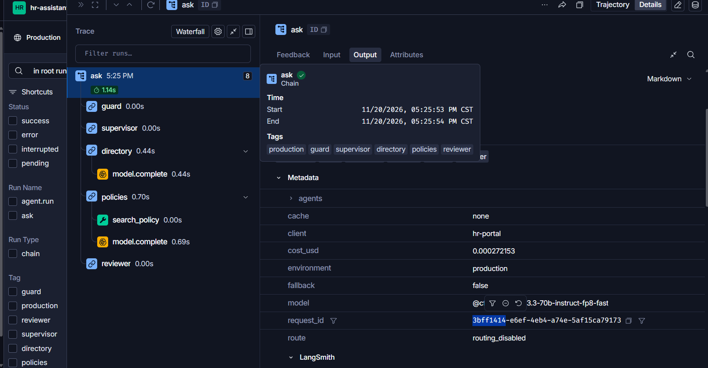
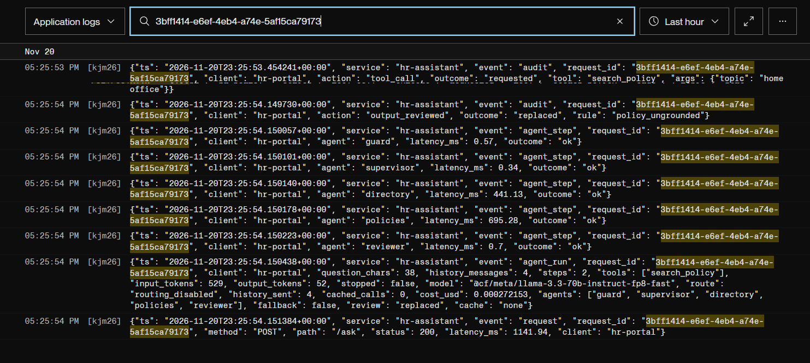
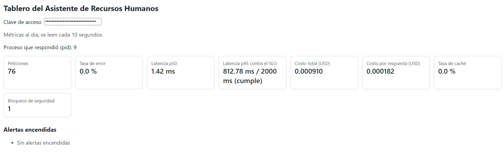
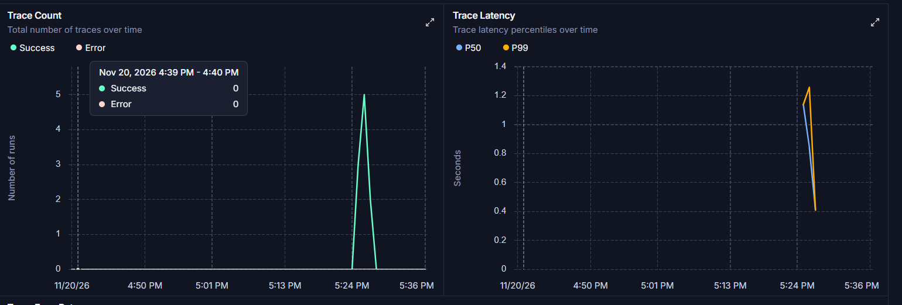
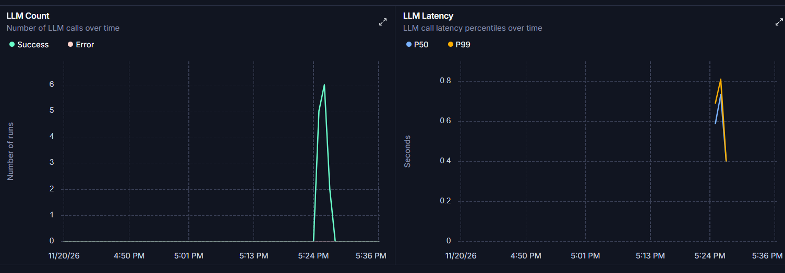
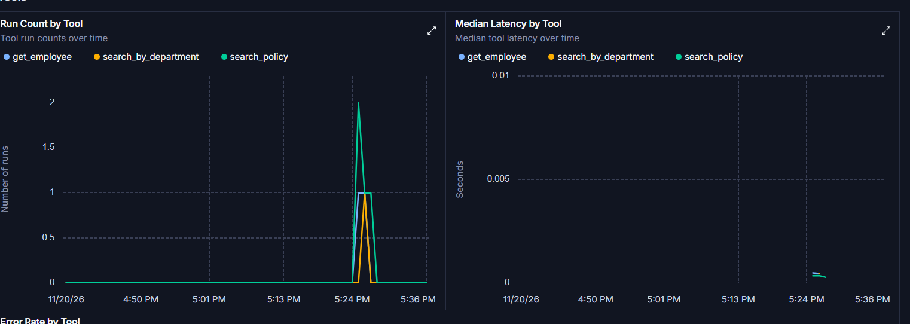
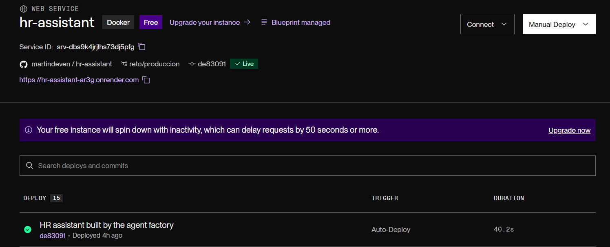
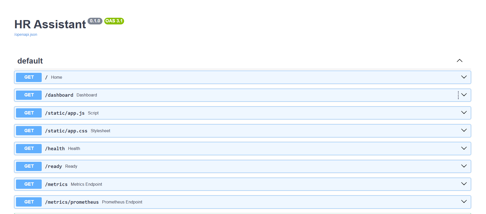

# Evidencia: observabilidad en producción

- **Servicio:** `https://hr-assistant-ar3g.onrender.com` (rama `reto/produccion`, 2 procesos).
- **Fecha:** 2026-11-20.
- **LangSmith:** proyecto `hr-assistant-prod`, con `HIDE_INPUTS` y `HIDE_OUTPUTS` en `true` por compliance.
- **Tráfico:** 10 preguntas de prueba desde la página, que cubren:
  - los dos especialistas y una pregunta mixta,
  - PII e inyección,
  - preguntas repetidas para la caché.

## 1. Una pregunta de punta a punta: `request_id` `3bff1414-e6ef-4eb4-a74e-5af15ca79173`

Pregunta mixta sobre el home office de EMP-0004. El supervisor eligió los dos especialistas.

### Traza en LangSmith



| Nodo | Latencia | Qué hizo |
| --- | --- | --- |
| `ask` (raíz) | 1.14 s | Una traza por pregunta; las etiquetas listan los agentes que corrieron |
| `guard` | 0.00 s | Reglas de PII e inyección; sin modelo |
| `supervisor` | 0.00 s | Eligió `directory` y `policies` por reglas; sin modelo |
| `directory` → `model.complete` | 0.44 s | Una llamada al modelo |
| `policies` → `search_policy` → `model.complete` | 0.70 s | Consultó la política y luego llamó al modelo |
| `reviewer` | 0.00 s | Revisó la salida; sin modelo |

Metadatos de la traza:

- `client: hr-portal` y `environment: production`.
- `model: @cf/meta/llama-3.3-70b-instruct-fp8-fast` y `route: routing_disabled`.
- `cost_usd: 0.000272153`, `cache: none` y `fallback: false`.
- `request_id`.

La traza no guarda la pregunta ni la respuesta: el compliance las oculta.

**Lectura:** los tres agentes de control (`guard`, `supervisor` y `reviewer`) suman menos de 2 ms. Casi todo el
tiempo y todo el costo están en los especialistas que llaman al modelo, como decidió el ADR 0013.

### El mismo `request_id` en Render > Logs



| Hora (UTC) | Evento | Contenido |
| --- | --- | --- |
| 23:25:53.454 | `audit` `tool_call` | `tool: search_policy`, `args: {"topic": "home office"}` |
| 23:25:54.149 | `audit` `output_reviewed` | `outcome: replaced`, `rule: policy_ungrounded` |
| 23:25:54.150 | `agent_step` x 5 | `guard` 0.57 ms, `supervisor` 0.34 ms, `directory` 441.13 ms, `policies` 695.28 ms, `reviewer` 0.7 ms; todos `ok` |
| 23:25:54.150 | `agent_run` | Tokens (529 de entrada y 52 de salida), modelo, costo, agentes, `review: replaced` y `cache: none`; solo `question_chars: 38`, nunca el texto |
| 23:25:54.151 | `request` | `POST /ask`, `200`, 1141.94 ms |

La latencia de cada agente coincide entre el log (`agent_step`) y la traza: 441 ms y 0.44 s en `directory`, 695 ms y
0.70 s en `policies`. Con un `request_id` se reconstruye la pregunta completa: qué agentes corrieron, qué
herramientas usaron, qué decidió el reviewer, cuánto costó y cuánto tardó.

## 2. Tablero `/dashboard`



| Indicador | Valor | Lectura |
| --- | --- | --- |
| Proceso que respondió | `pid` 9 | Las métricas son de ese proceso (hay 2) |
| Peticiones | 76 | Incluye `/health`, `/metrics` y la lectura del tablero cada 10 s; por eso el p50 es de 1.42 ms |
| Tasa de error | 0.0 % | |
| Latencia p95 contra el SLO | 812.78 ms / 2000 ms | Cumple |
| Costo total | USD 0.000910 | |
| Costo por respuesta | USD 0.000182 | 5 respuestas del modelo en este proceso |
| Tasa de caché | 0.0 % | Las preguntas repetidas cayeron en el otro proceso, que tiene su propia caché |
| Bloqueos de seguridad | 1 | La inyección de prueba |
| Alertas encendidas | Ninguna | |

## 3. Tablero de LangSmith (monitoreo del proyecto `hr-assistant-prod`)

Es el tablero que LangSmith arma solo para cada proyecto. Las gráficas cubren el tráfico de prueba, de 5:24 a
5:30 p. m. (hora del centro de México).

| Gráfica | Lo que muestra | Lectura |
| --- | --- | --- |
| Trace Count | Hasta 5 trazas por minuto, todas `Success` | Cada pregunta es una traza; sin errores |
| Trace Latency | p50 y p99 entre 0.4 y 1.3 s | Dentro del SLO de 2 s |
| LLM Count | Hasta 6 llamadas al modelo por minuto, sin errores | Más llamadas que trazas: una pregunta mixta llama dos veces (una por especialista) y las bloqueadas, ninguna |
| LLM Latency | p50 y p99 entre 0.4 y 0.8 s | El modelo es casi toda la latencia de una traza |
| Run Count by Tool | `get_employee`, `search_by_department` y `search_policy` | Cada especialista usa solo sus herramientas |
| Median Latency by Tool | Menos de 1 ms | Las herramientas son lecturas locales; el costo está en el modelo |







Los desgloses por agente, cliente y modelo están en `/metrics` (`by_agent`, `by_client` y `by_model`). En
LangSmith se filtran con las etiquetas de cada agente y con los metadatos `client` y `model` de cada traza.

## 4. Métricas en formato Prometheus (`/metrics/prometheus`)

Piden clave y el permiso `metrics`; sin clave responden `401`. Cada serie lleva el `pid` del proceso y nunca el
cliente ni el `request_id`, para no crear una serie por petición.

```bash
curl -s https://hr-assistant-ar3g.onrender.com/metrics/prometheus -H "X-API-Key: $LOAD_API_KEY" | head -40
```

```text
# HELP hr_requests_total Requests by status
# TYPE hr_requests_total counter
hr_requests_total{status="200",pid="9"} 158
hr_requests_total{status="400",pid="9"} 1
hr_requests_total{status="401",pid="9"} 2
# HELP hr_request_latency_ms Request latency in milliseconds
# TYPE hr_request_latency_ms histogram
hr_request_latency_ms_bucket{le="50",pid="9"} 156
hr_request_latency_ms_bucket{le="100",pid="9"} 156
hr_request_latency_ms_bucket{le="250",pid="9"} 156
hr_request_latency_ms_bucket{le="500",pid="9"} 156
hr_request_latency_ms_bucket{le="1000",pid="9"} 159
hr_request_latency_ms_bucket{le="2000",pid="9"} 161
hr_request_latency_ms_bucket{le="5000",pid="9"} 161
hr_request_latency_ms_bucket{le="10000",pid="9"} 161
hr_request_latency_ms_bucket{le="+Inf",pid="9"} 161
hr_request_latency_ms_sum{pid="9"} 5117.960000000004
hr_request_latency_ms_count{pid="9"} 161
# HELP hr_agent_runs_total Agent steps by agent and outcome
# TYPE hr_agent_runs_total counter
hr_agent_runs_total{agent="directory",outcome="ok",pid="9"} 4
hr_agent_runs_total{agent="guard",outcome="blocked",pid="9"} 1
hr_agent_runs_total{agent="guard",outcome="ok",pid="9"} 5
hr_agent_runs_total{agent="policies",outcome="ok",pid="9"} 2
hr_agent_runs_total{agent="reviewer",outcome="ok",pid="9"} 5
hr_agent_runs_total{agent="reviewer",outcome="skipped",pid="9"} 1
hr_agent_runs_total{agent="supervisor",outcome="ok",pid="9"} 5
hr_agent_runs_total{agent="supervisor",outcome="skipped",pid="9"} 1
# HELP hr_tokens_total Model tokens
# TYPE hr_tokens_total counter
hr_tokens_total{direction="input",pid="9"} 1907
hr_tokens_total{direction="output",pid="9"} 156
# HELP hr_cost_usd_total Model cost in USD
# TYPE hr_cost_usd_total counter
hr_cost_usd_total{model="@cf/meta/llama-3.3-70b-instruct-fp8-fast",pid="9"} 0.0009102189999999999
# HELP hr_guardrail_events_total Guardrail events by type
# TYPE hr_guardrail_events_total counter
hr_guardrail_events_total{type="forbidden",pid="9"} 0
hr_guardrail_events_total{type="injection_blocked",pid="9"} 1
hr_guardrail_events_total{type="output_replaced",pid="9"} 1
```

**Las cuentas cuadran entre agentes:**

- `guard` corrió 6 veces: 5 `ok` y 1 `blocked`, la inyección.
- La pregunta bloqueada no llegó a los demás: `supervisor` y `reviewer` la marcan como `skipped`.
- Las 5 que pasaron fueron a 4 `directory` y 2 `policies`; una mixta corre los dos.

**Las cuentas cuadran con las otras salidas:**

- El costo (`hr_cost_usd_total` = 0.000910) es el mismo «Costo total» del tablero `/dashboard`.
- La inyección se cuenta igual en `hr_guardrail_events_total`, en «Bloqueos de seguridad» del tablero y en el
  evento `audit`.
- `output_replaced` = 1 es el reemplazo del reviewer de la sección 1.

El histograma de latencia muestra 161 peticiones: 156 de menos de 50 ms (`/health`, `/metrics` y el tablero) y 5
entre 500 ms y 2 s (las preguntas al modelo). Todas quedan dentro del SLO de 2 s.

## 5. Servicio en Render



- Servicio `hr-assistant` en Docker, plan Free, administrado por Blueprint (`render.yaml`).
- Rama `reto/produccion`, commit `de83091`, estado **Live**.
- Último despliegue automático en 40.2 s (`autoDeployTrigger: checksPass`), después de que pasó el CI.
- El plan Free duerme el servicio tras un rato sin uso; la primera petición puede tardar 50 s o más.

## 6. API documentada (`/docs`)



Rutas públicas:

- `/`, `/dashboard` y `/static/app.*`: la página y el tablero, servidos bajo la CSP.
- `/health` y `/ready`.

Rutas con clave:

- `/metrics` y `/metrics/prometheus`: piden además el permiso `metrics`.
- `POST /ask`: aparece más abajo en `/docs`.

## Hallazgo: falso positivo del reviewer

En la pregunta mixta, el reviewer reemplazó la parte de `policies` (`rule: policy_ungrounded`), aunque la consulta
a la política sí ocurrió. Lo más probable es que la respuesta incluyera el número de `EMP-0004`, que no aparece en
el texto de la política y la regla cuenta como cifra. El usuario recibe el texto literal de la política: la
respuesta sigue siendo correcta, pero menos natural.

**Riesgo residual:** respuestas mixtas más rígidas.
**Mejora:** excluir los ids `EMP-####` de la verificación de cifras.
